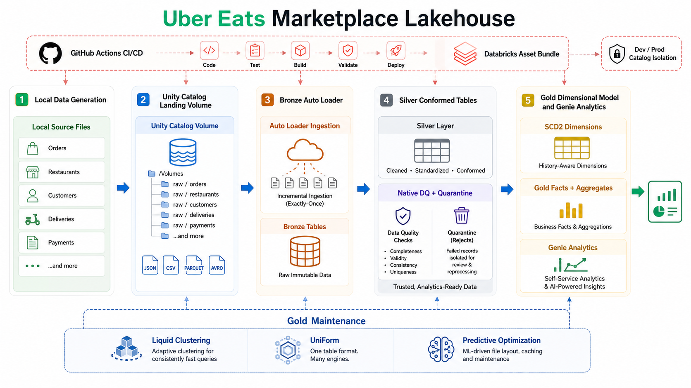
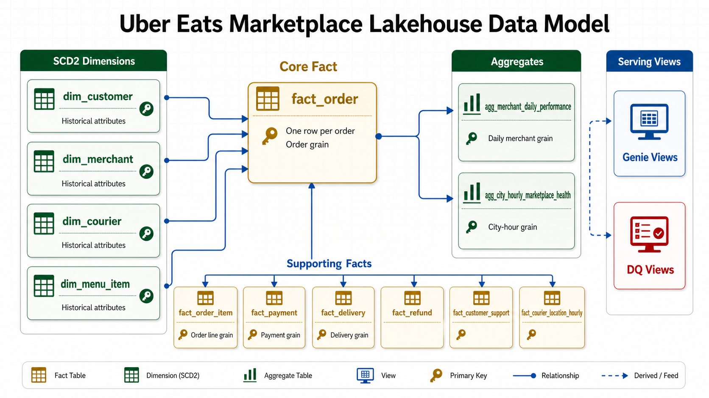
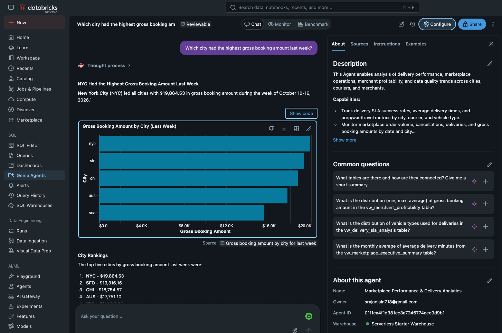

# Uber Eats Marketplace Lakehouse

This repository implements an end-to-end Databricks lakehouse for an Uber Eats-style food delivery marketplace. It is designed for Databricks Free Edition while keeping the architecture close to patterns used in production data platforms.

The solution includes Unity Catalog setup, Auto Loader ingestion, a medallion architecture, incremental batch processing, SCD Type 2 dimensions, optimized facts and aggregates, native Spark SQL data quality checks, quarantine tables, Databricks Jobs, Databricks Asset Bundles, GitHub CI/CD templates, unit tests, and Genie-ready analytical views.

## Genie Agent

The **Marketplace Performance & Delivery Analytics** Genie agent lets users explore the lakehouse through plain-language questions. It uses curated Gold and data quality views to answer questions about order volume, gross booking amounts, delivery SLA performance, estimated platform commission, and quarantined records.

The pipeline's final notebook, [`01_publish_genie_views.py`](notebooks/06_genie/01_publish_genie_views.py), publishes the views to add to the Genie space. The [Genie Agent Instructions](docs/03_GENIE_AGENT_INSTRUCTIONS.md) provide the source objects, business definitions, agent instructions, and example questions for configuration.

**Marketplace performance:** Asking "Which city had the highest gross booking amount last week?" produces a city comparison and a written summary using the project's generated sample data.

**Merchant performance:** Asking "Show top merchants by estimated platform commission" produces a merchant ranking, chart, and supporting results. The screenshot also shows the agent instructions that guide its use of the curated views.

## Documentation

Start with the overview, then use the technical guide as the execution runbook:

- [Project Overview And Business Outcomes](docs/01_PROJECT_OVERVIEW_AND_BUSINESS_OUTCOMES.md)
- [Technical Setup Deployment And Execution Guide](docs/02_TECHNICAL_SETUP_DEPLOYMENT_AND_EXECUTION_GUIDE.md)
- [Genie Agent Instructions](docs/03_GENIE_AGENT_INSTRUCTIONS.md)
